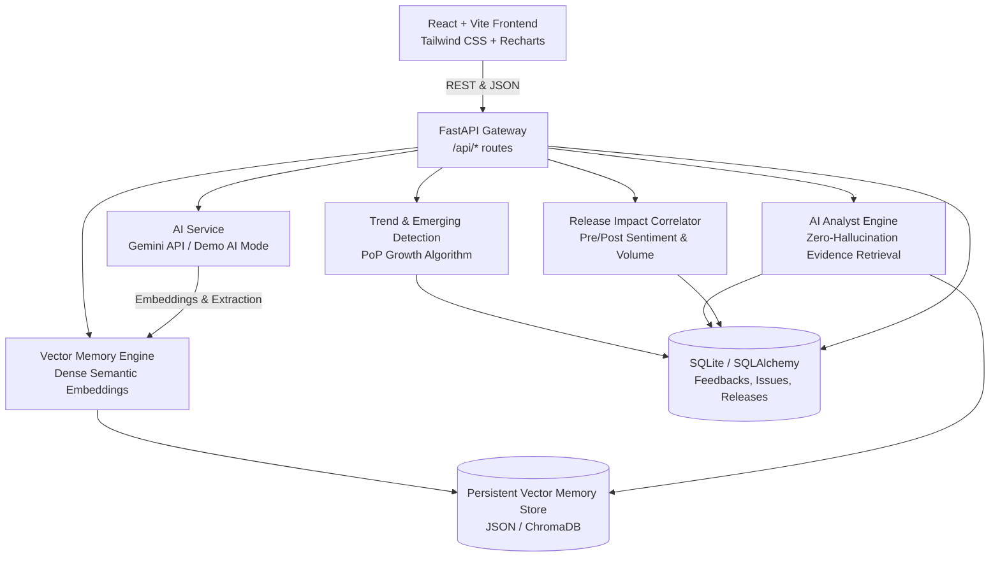

# AETHER System Architecture

Tagline: *"From scattered feedback to connected memory and emerging product insights."*

## 1. High-Level Architecture Overview

## 2. Ingestion & Semantic Memory Pipeline

When new customer feedback enters the system:
1. **AI Extraction**: The incoming text is analyzed for sentiment polarity, sentiment confidence score (0.0 - 1.0), dominant topic, product area, contextual feature, issue hypothesis, severity (`low`, `medium`, `high`, `critical`), intent (`complaint`, `bug_report`, `feature_request`, `praise`, `question`), keywords, and a 1-sentence summary.
2. **Dense Vector Embedding**: An L2-normalized semantic vector is generated.
3. **Memory Retrieval & Clustering**: Vector memory is queried for historical feedback records exhibiting high cosine similarity ($sim \ge 0.65$).
4. **Issue Connection**: If top matches belong to an existing issue, the feedback is linked to that issue, and a `FeedbackIssueRelationship` edge is recorded. If no existing issue matches, a new issue is generated.
5. **Explainable Trend Update**: Period-over-period metrics are recalculated. If $mentions \ge 5$ and $growth \ge 25\%$, the issue status is set to `EMERGING`.

## 3. Emerging Issue Detection Algorithm

$$\Delta_{growth} = \frac{M_{current} - M_{previous}}{\max(M_{previous}, 1)} \times 100\%$$

- **Current Window ($M_{current}$)**: Customer mentions in the trailing 14 days.
- **Previous Window ($M_{previous}$)**: Customer mentions in the 14 days preceding the current window.
- **Emerging Trigger**: When $M_{current} \ge 5$ and $\Delta_{growth} \ge +25\%$, the issue is classified as `EMERGING` with a prominent badge and channel impact alerts.

## 4. Zero-Hallucination AI Analyst & Evidence Grounding

The AI Analyst is grounded directly in SQL aggregation queries and cosine vector memory retrieval:
- Answers cite exact numbers verified in SQLite (`total_mentions`, `growth_percentage`, `channel_distribution`).
- Every assertion is linked to supporting evidence records via the `evidence` payload.
- Users can click **"View Supporting Feedback"** to inspect the verbatim feedback items backing any claim.
